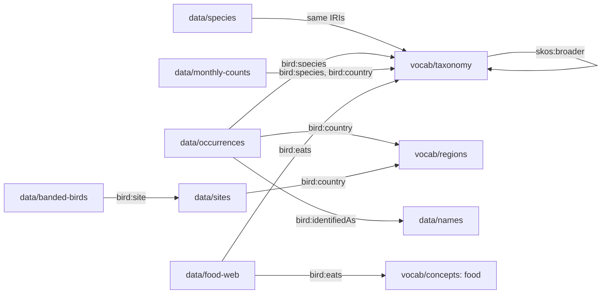

# Birds dataset

A small, curated RDF dataset of 111 bird species in 13 countries. It has a
taxonomy, traits, occurrences with points, monthly record counts, sites with
boundaries, banded birds, a food web and the history of scientific names. An
OWL ontology, SKOS vocabularies, SHACL shapes and SRL rule sets come with it.

It is the shared demo dataset for:

- sqlib: queries, SRL rules, query groups, tests, ETL and benchmarks;
- Wrybill: the ontology, the SKOS vocabularies and the search pages;
- Fuseki with the Kurrawong Lucene index: text, spatial and faceted search.

## Contents

| Path | Contents | Triples |
| --- | --- | --- |
| `ontology/birds.ttl` | Classes and properties | 268 |
| `ontology/shapes.ttl` | SHACL shapes that the data conforms to | 192 |
| `vocab/taxonomy.ttl` | 22 orders, 57 families, 86 genera and 111 species from AviList v2025 | 3,485 |
| `vocab/regions.ttl` | UN M49 regions and subregions, and 13 countries with Natural Earth boundaries | 267 |
| `vocab/concepts.ttl` | Ranks, migration, habitats, trophic niches, lifestyles, Red List categories, seasons, seasonal status, site types, name change types, food resources | 649 |
| `data/species.ttl` | Traits from AVONET, Red List category, AviList range text and a species account | 1,792 |
| `data/occurrences.ttl` | 2,081 GBIF occurrences with points, 2015 to 2025, CC0 and CC BY 4.0 only | 29,114 |
| `data/monthly-counts.ttl` | GBIF record counts for each species, country and month | 16,861 |
| `data/sites.ttl` | 22 sites (estuaries, tidal flats, wetlands) with approximate boundaries | 220 |
| `data/banded-birds.ttl` | 16 banded birds and 40 resightings with notes | 368 |
| `data/food-web.ttl` | 129 links from a species to a food resource or to another species | 129 |
| `data/names.ttl` | Scientific names and 18 name changes: genus moves, splits by country, a lump | 488 |
| `data/inferred-traits.nt` | The output of the rule set `trait-inheritance`, for the Lucene index | 819 |
| `rules/*.srl` | Five SRL rule sets. See [rules/README.md](rules/README.md) | |
| `rules/expected/` | The triples that each rule set infers | |
| `fuseki/config.ttl` | A Fuseki dataset with two Lucene indexes, `birds` and `vocab` | |
| `catalogue.ttl` | DCAT description of the dataset and its parts | |
| `etl/` | Source extracts, authored CSV files and the scripts that build everything | |

[NOTICE.md](NOTICE.md) lists each source, its licence and its citation.

## IRIs

| Kind | Pattern |
| --- | --- |
| Ontology terms | `https://example.org/birds/def/{term}` |
| Concepts | `https://example.org/birds/vocab/{scheme}/{concept}`, for example `vocab/taxon/limosa-lapponica` |
| Instances | `https://example.org/birds/id/{kind}/{id}`, for example `id/occurrence/4120377882` |

A species is a `skos:Concept` in the taxonomy scheme and a `bird:Species`. Its
traits are on the same IRI.

## How the parts fit

## Design choices

- **Trait inheritance.** `data/species.ttl` states trophic niche, habitat
  and lifestyle on an order, family or genus, as the most common value of
  all AVONET species in that taxon. A species or lower taxon states its own
  value only where it differs. The rule set `trait-inheritance` restores the
  value of each species. Its output matches the AVONET value for all 111
  species ([rules/expected/trait-inheritance-species.ttl](rules/expected/trait-inheritance-species.ttl)).
- **Old names.** 109 occurrences carry `bird:identifiedAs` with an earlier
  name. GBIF files Australian records of the grey fantail, the pied stilt and
  the rainbow lorikeet under names that a split now limits to other
  countries. The build files them under the current species. Other old names
  are assigned to every third record of an affected species, as test data.
- **Monthly counts reflect observer effort.** For example, more people
  photograph red-crowned cranes at the winter feeding sites in Hokkaido, so
  the rule set `seasonal-status` calls the species a winter visitor in Japan.
  The rule reports what the records show, which is a useful lesson.
- **Facet hierarchies have a fixed depth.** The Kurrawong index can facet a
  hierarchy only when every level is a fixed path. Taxonomy (order, family,
  genus) and geography (region, subregion, country) both have three levels.
- **Made-up data is marked.** The banded birds, their resightings, the site
  boundaries and the assignment of old names to records are made up.
  [NOTICE.md](NOTICE.md) says so.

## Build

The checked-in files are the build output. To build again:

1. Run `just setup` to install the Python packages.
2. Run `just extract` to download AviList and AVONET and extract the rows.
3. Run `just fetch` to fetch GBIF records. It takes about 40 minutes.
4. Run `just build` to write `vocab/` and `data/`.
5. Run `just rules` to run the rule sets. Set `SQLIB_CLI` to the sqlib command
   line, for example `SQLIB_CLI="node ../sqlib/packages/cli/dist/cli.js"`.
6. Run `just validate` to check the data against the shapes.

The authored inputs are in `etl/authored/`: species accounts, sites, banded
birds, resightings, the food web, name changes, countries and Māori names.

## Full tier

`just full` builds a larger tier into `dist/full`: every taxon of AviList
v2025 (11,131 species, about 122,000 triples and 6 MB) and a GBIF pull of 10
records a month in up to 13 countries. It is not kept in git. `just package`
packs each part, and the full tier when it exists, into `dist/release` for a
GitHub release.

## Use it

| Consumer | Parts | How |
| --- | --- | --- |
| sqlib-demo | `data`, `vocab`, `rules` | Pin a release tag and download its archives in the seed step |
| Wrybill | `ontology`, `vocab`, and `data` for the search pages | Load the archives of a pinned tag in `scripts/jena-demo.sh` |
| Fuseki | All parts, and `full` if wanted | Download the archives at build time, load them into TDB2 with `data/inferred-traits.nt`, then build the indexes |

## Not done yet

- The Fuseki configuration has not been run against the Kurrawong image.
  Check it with `luc:config` and `luc:stats` before you rely on it.
- No release is published yet.
- No GBIF derived-dataset DOI. It needs a GBIF account.
- Names in languages other than English and Māori. Wikidata (CC0) has them,
  but its API refused requests from the build machine.

## Licence

The data, vocabularies, ontology and rules are CC BY 4.0. The scripts in
`etl/scripts/` are MIT. Source data keeps its own licence, as
[NOTICE.md](NOTICE.md) lists.
